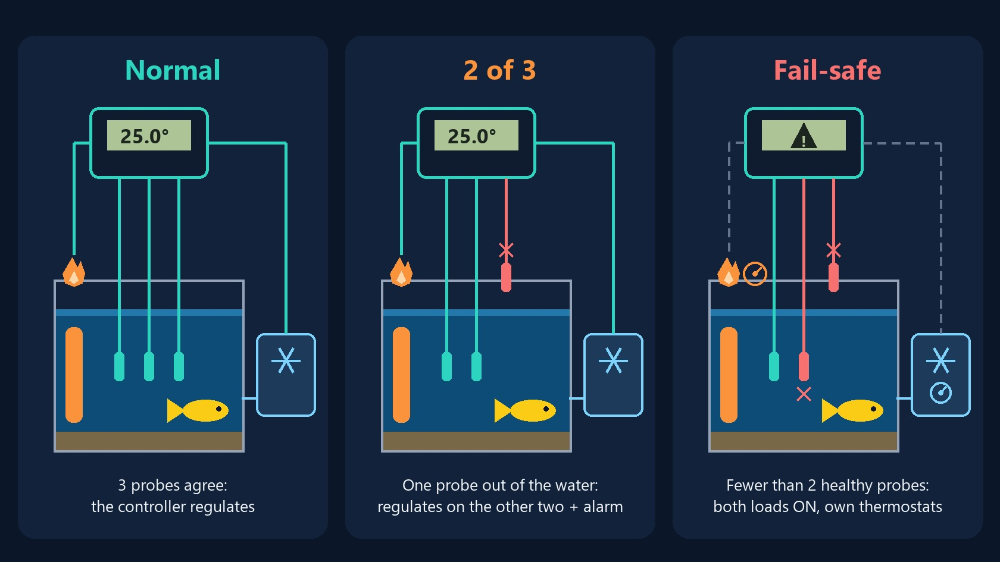

<p align="center"></p>

# Aquatermostat Firmware

Safety-critical ESP32-C3 thermostat for a **marine aquarium** heater (220 V mains via relay), with triple-redundant NTC sensing (ADS1115), fault detection, Nokia 5110 display, web UI, MQTT + Home Assistant discovery, and OTA updates.

> **Safety first:** the higher-priority FreeRTOS control task (sensors → thermostat → relay) runs independently of WiFi / MQTT / web / display work. Network and display failures cannot block it. The device regulates temperature even with no network and no display.

<p align="center"></p>

**Normal**: three probes agree and the controller regulates heater and chiller. **2 of 3**: one probe is faulty or out of the water; the controller keeps regulating on the two that agree and raises an alarm. **Fail-safe** (fewer than two healthy probes, ADC reference fault or controller down): both loads are powered and each appliance's own built-in thermostat takes over.

## Features

- **Triple Redundant Sensing**: three NTC 10 kΩ probes, per-probe fault detection, robust median fusion
- **Fail-safe policy** (marine tank, mechanical thermostats as last resort):
  - At least **2 healthy, agreeing probes** within the trust window (12–44 °C) → firmware regulates on their mean (single band: heat OR cool); a third faulty probe only raises an alarm
  - Fewer than 2 healthy probes (a single probe cannot be verified), ADC reference fault, or temperature outside the trust window → **both relays ON**, delegates to heater + chiller mechanical thermostats
- **Relay boot state (NC)**: relays are Normally-Closed → at boot/reset/crash both loads are ON (the fail-safe state). The controller energizes a relay only to turn a load OFF. Requires heater internal thermostat < chiller internal thermostat.
- **Dual-action control, two independent thresholds**: `hysteresis` (heat below setpoint) and `coolDeadband` (cool above setpoint), defaults 0.5/0.5 ≈ 1 °C swing; cooler returns to setpoint (long runs, compressor-friendly) + 5 min anti-short-cycle
- **Enable flags**: heating and cooling can be independently enabled/disabled during normal trusted control; sensor fail-safe always turns both loads ON
- **Actuator fault alarms** (MQTT/HA → Telegram): adaptive "progress watchdog" (heater/cooler not moving temperature) + per-probe fault; fault stall timeouts auto-computed from tank liters + heater/chiller power (W or HP)
- **Web UI** (port 80, Tailwind responsive): live state badge (heating/idle/cooling/fail-safe), setpoint, the two thresholds (red/blue), enable toggles, alarm/power config + "Calc" box, per-probe offsets, display contrast/brightness — all persisted to NVS
- **MQTT**: state publish every 10 s + Home Assistant MQTT discovery (incl. alarm binary_sensors)
- **OTA**: firmware upload via `/update` (ElegantOTA), no USB needed
- **Nokia 5110 display** (optional, best-effort): average temp, setpoint, heater state, 3 probes
- **WiFi**: direct STA with non-blocking infinite retry, captive-portal fallback (WiFiManager)

## Hardware

> 📐 Schema completo del circuito (diagramma Mermaid + ASCII dettagliato): [`docs/HARDWARE.md`](docs/HARDWARE.md).

- **MCU**: ESP32-C3 Super Mini (2.4 GHz only)
- **ADC**: ADS1115 16-bit, I2C `0x48` — probes on AIN0/AIN1/AIN2
- **Relays**: two SONGLE SRD-05VDC, opto-isolated, **ACTIVE-HIGH**, Normally-Closed contact (load ON when relay de-energized = GPIO low)
  - **HEAT relay** (GPIO2): controls the 220 V heater
  - **COOL relay** (GPIO10): controls the 220 V chiller (independent; fail-safe mode can energize both)
- **Display**: Nokia 5110 / PCD8544, 84×48, **software SPI**
- **I2C** (ADS1115): GPIO8 (SDA), GPIO9 (SCL)

### NTC divider (real topology)

`3.3V → Rfix(10 kΩ) → AIN → NTC → GND` (NTC on the GND side; tap the AIN at the node between Rfix and NTC). `Rntc = Rfix · Vadc / (Vcc − Vadc)`, ~1.65 V at 25 °C, NTC B=3435, R0=10 kΩ. **Missing the GND leg → AIN floats ~3.3 V → reads ~418 °C on all probes.**

### Nokia 5110 → ESP32-C3 wiring

| 5110 | ESP32-C3 | Note |
|------|----------|------|
| CLK  | GPIO4    | SPI clock |
| DIN  | GPIO6    | SPI MOSI |
| DC   | GPIO3    | data/command |
| CE   | GPIO7    | chip select |
| RST  | GPIO5    | reset |
| BL   | GPIO1    | backlight (PWM, brightness from web) |
| VCC  | 3V3      | **3.3 V only** (C3 is not 5 V tolerant) |
| GND  | GND      | |

> The 5110 backlight is powered **independently** from VCC: a lit backlight does **not** prove the logic is powered. Backlight on + totally blank screen (no response to contrast) usually means VCC/GND not connected or a dead panel.

> **Mount the probes low**, below the lowest water level reached during a water change. If all three emerge into room air together they agree with each other and would be trusted; the appliances' own thermostats bound the damage, but the reading is wrong until the level is restored.

## Wiring: relays & 220 V power

### ESP32-C3 GPIO pinout (low-voltage side)

| GPIO | Function | Module | Note |
|------|----------|--------|------|
| 1    | LCD backlight (PWM) | display | brightness control |
| 2    | HEAT relay control (IN) | SONGLE relay #1 | **strapping pin** — NC relay: load ON at boot (fail-safe), see wiring |
| 3    | LCD DC | display | |
| 4    | LCD CLK | display | |
| 5    | LCD RST | display | |
| 6    | LCD DIN | display | |
| 7    | LCD CE | display | |
| 8    | I2C SDA | ADS1115 | |
| 9    | I2C SCL | ADS1115 | |
| 10   | COOL relay control (IN) | SONGLE relay #2 | chiller (independent) |

### Relay module wiring (low-voltage, 5 V / 3.3 V logic side)

Each SONGLE SPDT module is **ACTIVE-HIGH** (opto-isolated) on this device (verified in the field):

```
VCC (5 V) ──┬─ relay coil (inside module)
            └─ (optocoupler anode, fed internally)

IN (GPIO) ──┬─── optocoupler gate
            │
            └─ 10 kΩ pull-DOWN resistor to GND
               • HIGH: relay **ENERGIZED** (coil ON) → NC opens → load OFF
               • LOW or floating: relay **DE-ENERGIZED** (coil OFF) → NC closed → load ON

GND ──┬─ relay GND
      └─ optocoupler cathode, common with ESP32-C3 GND

COM ─────────────── common (mains side)
NO (Normally-Open) ─ not used (isolate or leave open)
NC (Normally-Closed) ─ load when relay **DE-ENERGIZED** (coil OFF) = at rest
```

**Pull-DOWN 10 kΩ to GND** on each GPIO2 and GPIO10: before firmware runs (at boot, reset, or brown-out), the GPIO stays low → relay de-energized → **both NC contacts close** → both loads are ON (fail-safe delegation to mechanical thermostats). In fail-safe the firmware also drives both pins **LOW**.

**Wiring for HEAT relay (GPIO2 → HEAT module)**:
- `VCC` → 5 V
- `GND` → GND (common with ESP32-C3)
- `IN` → GPIO2 (with 10 kΩ pull-down to GND)
- `COM` → mains PHASE (live)
- `NC` → heater load (connects to heater, return via NEUTRAL)
- `NO` → **not used** (isolate or leave open)

**Wiring for COOL relay (GPIO10 → COOL module)**:
- `VCC` → 5 V
- `GND` → GND (common with ESP32-C3)
- `IN` → GPIO10 (with 10 kΩ pull-down to GND)
- `COM` → mains PHASE (live, **independent from HEAT**)
- `NC` → chiller load (connects to chiller, return via NEUTRAL)
- `NO` → **not used** (isolate or leave open)

### 220 V wiring diagram (independent relays, fail-safe architecture)

```
MAINS PHASE (L) ──┬──────────────────────┬──────────────────────┐
                  │                      │                      │
            HEAT relay COM         COOL relay COM               │
                  │                      │                      │
                  ├─ NC ──────► HEATER ──┤                      │
                  │                      │                      │
                  └─ NO (unused)    ┌────┴─► NEUTRO (N) return │
                                    │                          │
                  ┌─────────────────┴─ NC ──────► CHILLER ──┐   │
                  │                                         │   │
                  └───────────────────────────────────────┬─┘   │
                                                          │     │
MAINS NEUTRAL (N) ────────────────────────────────────────┴─────┘
                                              (common return)

PROTECTIVE EARTH (PE) ──► equipment chassis (heater, chiller)
                         [required for marine / wet installations]
```

### Fail-safe policy (Normally-Closed relays, no hardware interlock)

With **Normally-Closed independent relays**, the firmware implements intelligent fail-safe control:

1. **All sensor readings are valid and corroborated, and temperature is within trust window** (12–44 °C):
   - Firmware runs dual-band thermostat: the controller **energizes (drives HIGH) at most one relay at a time** to disable either heating or cooling.
   - Deadband + hysteresis prevent simultaneous activation (e.g., heat threshold 24.5 °C, cool threshold 26 °C, 1 °C hysteresis).
   - At all other moments, relays are de-energized → both NC contacts are closed → both loads are ON.

2. **Fewer than 2 healthy probes, ADC fault, or temperature outside 12–44 °C** (probes can be invalid, uncorroborated, frozen or jump-locked; with 2 of 3 healthy the firmware keeps regulating):
   - **Both relays are de-energized** → both NC contacts close → **HEATER and CHILLER loads are ON simultaneously** → delegate to mechanical thermostats inside heater and chiller.
   - This includes any reading below 12 °C or above 44 °C: such values are treated as untrustworthy (sensor fault), so control is handed to the devices' own thermostats.

3. **Boot, reset, brown-out, or firmware crash**:
   - Pull-down resistors keep both GPIO2 and GPIO10 low → both relays de-energized → both NC contacts closed → **both loads ON** (inherent fail-safe, delegates to mechanical thermostats).

### Critical setup requirement for Normally-Closed relays

Since both loads are ON by default (at boot, during failures, or when temperature is untrustworthy), the heater and chiller **must not fight each other** in fail-safe mode:

⚠️ **The heater's mechanical thermostat MUST be set LOWER than the chiller's mechanical thermostat** (e.g., heater 24.5 °C, chiller 26 °C). Otherwise both devices cycle continuously, wasting energy and stressing the system. Verify and label the dials on your equipment. This is not a firmware quirk — it is a hard requirement of the fail-safe architecture with Normally-Closed loads.

### Trust window (fail-safe entry threshold)

The firmware uses a fixed trust window of **12–44 °C**. Fewer than 2 healthy probes, an ADC reference fault, or a measured temperature outside this range triggers fail-safe (both relays ON). `noValidProbe` means no electrically valid reading; `sensorFault` reports any probe problem (alarm); `controlFault` means the firmware does not regulate. The device does **not** depend on NTP for the trust window.

### Important notes on safety

- **Relay rating & current**: typical SONGLE SRD-05VDC is rated ~10 A @ 250 VAC. Verify your heater and chiller nameplate current and ensure **combined steady-state current < relay contact rating**. Undersized contacts → overheating → welding → loss of control.

- **230 V / 240 V / 50 Hz–60 Hz compatibility**: the circuit is mains-voltage–agnostic, but always verify your local wall voltage and follow national electrical codes.

- **Safety-critical** (Marine tank with valuable fish):
  1. **Firmware thermostat** (temperature validation, dual-band control, fail-safe escalation, fixed trust window 12–44 °C) is the primary safety layer.
  2. **Heater's and chiller's own mechanical thermostats** are the last-resort failsafe if the controller crashes, loses power, or distrusts the reading (heater must be set below chiller to avoid fighting in dual-on mode).

- ⚠️ **DANGER — 220 V mains**:
  - **Work with mains disconnected.** Isolate probe both sides of the plug before touching any contact.
  - **Never assume a relay is safe once de-energized.** Verify continuity on COM and NO contacts with a multimeter before touching.
  - **Protective earth (PE) is mandatory** for marine / wet installations. Connect heater and chiller chassis to the protective earth conductor.
  - Respect national electrical codes (CE mark, overcurrent protection, RCD / GFCI, proper cable gauges for current, etc.).
  - Do not use this circuit in life-support systems without additional independent safety certification and monitoring.

## Sensing, fault detection & control internals

### Sensor fusion pipeline (every 1 Hz cycle, per probe)

1. **Oversample** `PROBE_OVERSAMPLE` (=5) ADC reads → take the **median voltage** (kills single-sample spikes / EMI).
2. **Convert** to °C (Steinhart–Beta) + per-probe **offset**.
3. **Electrical plausibility** → INVALID if V≤0 (short→reads hot) or V≥Vcc (open→reads cold) or T∉[−10,80]°C.
4. **Rate-of-change filter** → if change > `maxRate` (°C/s, scaled by real elapsed time) the probe is excluded for `PROBE_JUMP_LOCKOUT_MS` (3 min), then re-seeded and retried.
5. **Frozen-probe detector** → a valid probe not moving >`PROBE_STUCK_EPSILON_C` (0.1°C) for `PROBE_STUCK_TIMEOUT_MS` (10 min) **while another valid probe is moving** is flagged faulted (differential anomaly → no false positive in stable water).
6. **Majority vote** → median of valid probes; a probe deviating >`faultThreshold` (0.4°C) is flagged faulted, **with hysteresis** (clears only below 0.2°C → no chatter at the edge).
7. **Fused temperature** = average of valid, non-faulted probes.
8. **Any sensor fault** (invalid, jump-locked, frozen, outlier, or uncorroborated reading) → reading untrusted → **fail-safe** (both ON, delegate to internal thermostats), even when other probes agree. A surviving median is never trusted alone during a fault.
9. **ADC reference guard** (`ADC_REF_ENABLED`): AIN3 (fixed divider) is read each cycle; if it leaves `ADC_REF_EXPECTED_V ± ADC_REF_TOLERANCE_V`, the shared rail/ADC is drifting → `adcFault` and `sensorFault` → fail-safe + alarm. `noValidProbe` still only means no electrically valid probe readings.

### Why a probe is excluded / faulted, and for how long

| Cause | Flag | Trigger | Duration / recovery |
|---|---|---|---|
| Open / short / out-of-range | `isValid=false` | NaN from plausibility check | recomputed every 1 Hz → instant in/out |
| Impossible jump (rate filter) | `isValid=false` (lockout) | change > `maxRate` °C/s | **3 min** fixed, then re-seed + retry |
| Deviates from the group | `isFaulted=true` | dev > `faultThreshold` (0.4) | until dev < 0.2 (hysteresis latch) |
| Frozen | `isFaulted=true` | still <0.1°C for 10 min while another moves | until it moves again / no mover / becomes invalid |

**Alarm** (notify): per-probe alarm fires after **30 s continuous** "bad" (`PROBE_FAULT_DEBOUNCE_MS`), clears instantly on recovery. Global probe alarm (all invalid) is immediate. Exclusion from control is immediate (no debounce); the 30 s debounce only gates the *notification*.

### Formulas & physical models

- **NTC** (divider `3.3V→Rfix→AIN→NTC→GND`): `Rntc = Rfix·Vadc/(Vcc−Vadc)`; `1/T = 1/T0 + (1/B)·ln(Rntc/R0)` (B=3435, R0=10k, T0=298.15K). Sensitivity ≈ **32 mV/°C @25°C**.
- **ADC**: `GAIN_ONE` (±4.096V) fits the 0–3.3V signal → 125 µV/LSB ≈ **0.004°C/LSB**; measurement noise ≈ 0.02°C after median-5.
- **Stall timeout** (heater/cooler fault watchdog), web "Calc": `t_stall[min] = margin(3) · (liters · 4186 · almStep) / W / 60`, clamped **[8, 45] min**.
- **Welded-relay timeout** (physical, auto): `t_weld[ms] = 1.3 · (liters · 4186 · ALARM_WELD_DELTA_C) / W · 1000`, clamped **[5, 60] min**; fallback `ALARM_WELD_TIMEOUT_MS` if liters/power unknown. ΔC = `ALARM_WELD_DELTA_C` (1.5°C). Rationale: a welded actuator runs at full power; if the temperature moves ΔC within this time while the actuator is commanded OFF, it can't be slow ambient heat (lights/room) → likely a welded contact.
- **Probe rate limit** (jump filter), web "Calc": water can't change faster than the strongest actuator → `rate_max[°C/s] = margin(5) · max(W_heat, W_cool) / (liters · 4186)`. UI shows it in °C/min (×60). Stored °C/s in NVS (`maxRate`).
- Specific heat of water `4186 J/kg/K`, `1 L ≈ 1 kg`. `1 HP ≈ 745.7 W`.

### Automatisms

- **Fail-safe entry is immediate; exit is re-evaluated every `FAILSAFE_RECHECK_MS` (30 s)** → T oscillating around `TRUST_MAX` can't chatter the actuators. The independent control task continues while network work is active.
- **Anti-short-cycle (cooler)**: `MIN_RELAY_OFF_TIME_MS` (5 min) minimum OFF before the chiller can restart (compressor oil-return). Timer pre-expired at boot so the first start isn't blocked.
- **Fail-safe exit resets to idle** (`prevFailSafe`): the both-ON state is not inherited → turn-on thresholds are respected.
- **Alarms** (notify-only, never touch control): progress watchdog (actuator ON but T not moving), per-probe (30 s debounce), over/under-temp (setpoint ± `ALARM_TEMP_BAND_C`, 0.3 °C hysteresis), welded-relay (commanded-vs-observed, physical timeout). Per-actuator watchdog is suspended in fail-safe (can't attribute); the probe alarm stays active.
- **NVS persistence**: setpoint, hysteresis, coolDeadband, enable flags, alarm step/timeouts, heater/cooler watts, cooler unit, liters, `maxRate`, offsets, contrast, brightness, MQTT config.
- **MQTT**: state every 10 s **+ immediate publish on any actuator or alarm change**; HA discovery republished once per connection.

### Key tunables (config.h)

| Constant | Default | Meaning |
|---|---|---|
| `TRUST_MIN` / `TRUST_MAX` | 12 / 44 °C | sensor-sane window; outside → fail-safe |
| `FAULT_THRESHOLD_DEFAULT` | 0.4 °C | vote deviation to flag a probe (clears at 0.2) |
| `PROBE_OVERSAMPLE` | 5 | ADC reads median'd per probe |
| `PROBE_MAX_RATE_C_PER_S` | 0.05 °C/s | default jump limit (runtime-configurable `maxRate`) |
| `PROBE_JUMP_LOCKOUT_MS` | 3 min | exclusion after an impossible jump |
| `PROBE_STUCK_EPSILON_C` / `_TIMEOUT_MS` | 0.1 °C / 10 min | frozen-probe detector |
| `MIN_RELAY_OFF_TIME_MS` | 5 min | chiller anti-short-cycle |
| `FAILSAFE_RECHECK_MS` | 30 s | fail-safe exit re-evaluation (anti-chatter) |
| `ALARM_PROGRESS_STEP_C` | 0.2 °C | progress step for the stall watchdog |
| `ALARM_STALL_TIMEOUT_MS` | 30 min | stall fallback (auto-computed from liters+W via Calc) |
| `ALARM_TEMP_BAND_C` | 2.5 °C | over/under-temp alarm band around the setpoint (0.3 °C hysteresis) |
| `ALARM_WELD_DELTA_C` / `_TIMEOUT_MS` | 1.5 °C / 30 min | welded-relay alarm (timeout auto-computed) |
| `PROBE_FAULT_DEBOUNCE_MS` | 30 s | per-probe alarm debounce |
| `ADC_REF_ENABLED` | 1 | enable the AIN3 reference guard (0 if not wired) |
| `ADC_REF_EXPECTED_V` / `_TOLERANCE_V` | 1.65 / 0.10 V | expected AIN3 reference (field-calibrated) and tolerance |

## Building & Uploading

First create `src/secrets.h` (gitignored; the build stops with a clear error if it is missing): either copy `src/secrets.example.h` and fill in your WiFi and MQTT credentials, or generate it from a `.env` file with `python tools/secrets_from_env.py path/to/.env` (variables `AQUATERMOSTAT_WIFI_SSID`, `AQUATERMOSTAT_WIFI_PASSWORD`, `AQUATERMOSTAT_AP_PASSWORD`, `AQUATERMOSTAT_MQTT_HOST`, `MQTT_USER`, `MQTT_PASSWORD`).

PlatformIO (Windows / PowerShell):

```powershell
$pio = "$env:USERPROFILE\.platformio\penv\Scripts\pio.exe"
& $pio run                                               # build
& $pio run -t upload --upload-port COM7                  # flash (check the COM port)
& $pio device monitor -p COM7 -b 115200 --dtr 1 --rts 0  # serial
```

Tests (no hardware needed): `pio test -e native` (pure C logic, needs a host `gcc`), `node --test web/*.test.mjs` (web Calc math), `python tools/lcd_preview/render.py` (pixel-exact LCD preview into `docs/img/lcd_preview.png`).

> **USB-Serial-JTAG of the C3 is flaky on upload** (`Packet content transfer stopped` / `chip stopped responding`). Just **retry** — it usually succeeds on the 2nd–3rd attempt. Not a code bug.

## Networking

- **Credentials**: copy `src/secrets.example.h` to `src/secrets.h` (gitignored) and fill in SSID, WiFi password, setup-portal password and MQTT broker/user/password
- **mDNS** `aquatermostat.local` (IP assigned by your router's DHCP)
- Fallback captive portal (WiFiManager) `Aquatermostat-Setup` if STA fails
- **WiFi TX power is forced to max** (`WiFi.setTxPower(WIFI_POWER_19_5dBm)`): the C3 Super Mini's PCB antenna is weak; at default power the AP logs `did not acknowledge authentication response` and the STA never associates.

### Web API

- `GET /api/status` — full JSON state (probes, average, `noValidProbe`, `sensorFault`, setpoint, heater/cooler/failsafe, alarms, calibration offsets, network and MQTT status)
- `POST /api/config` — JSON body (`Content-Type: application/json`), any subset of: `setpoint` (20–30), `hysteresis` (0.3–1.0), `coolDeadband`, `enableHeat`, `enableCool`, `almStep`, `almStallHeatMin`, `almStallCoolMin`, `heaterWatts`, `coolerWatts`, `coolerHp`, `tankLiters`, `maxRate` (°C/s), `contrast` (0–127), `brightness` (0–255), `offset0..2` (±5). Values are clamped; a wrong JSON type (e.g. a string) rejects the whole request with 400. All persisted to NVS.
- `POST /api/mqtt/config` — JSON `mqtt_host`, `mqtt_port`, `mqtt_base`, optional `mqtt_user`/`mqtt_pass` (omitted = keep current; the password is never returned)
- `/update` — OTA

### Web "Calc" buttons (automatisms)

Three Calc buttons fill fields from a physical model; nothing is saved until you press **Salva** (you can edit the computed values first):
- **Calcolo Soglie box** → fills heater & cooler stall timeouts from tank liters + power.
- **Calc next to stall timeout** → same, from the main form fields.
- **Calc next to "Soglia Salto Sonda"** → fills the probe rate-filter threshold from tank liters + power.

See **Formulas & physical models** below for the equations.

### MQTT

Any MQTT broker (tested with EMQX and Mosquitto); host and credentials in `src/secrets.h`, editable later from the web UI. Base topic `aquatermostat`.
Topics: `<base>/temperature`, `/probe1..3`, `/heater`, `/setpoint`, `/hysteresis`, `/fault`, `/status` (retained), `/availability` (LWT). Home Assistant discovery under `homeassistant/...`.

### Alarms (MQTT / Home Assistant)

The device monitors heater and cooler health and publishes alarm states when an actuator fails to respond. Alarms are useful for alerting operators to equipment malfunction.

**Alarm types:**

- **Heater fault**: heater relay has been ON for ~30 minutes without the temperature rising by at least 0.3 °C. Indicates possible heater malfunction or load disconnection.
- **Cooler fault**: cooler relay has been ON for ~30 minutes without the temperature dropping by at least 0.3 °C. Indicates possible chiller malfunction or load disconnection.
- **Probe fault**: at least one sensor is invalid or untrusted, or no valid probes remain. The `/api/status` and MQTT status expose both `noValidProbe` and `sensorFault`.

**MQTT topics (publish):**

- `<base>/alarm/heater` — `ON` (fault detected) or `OFF` (heater healthy)
- `<base>/alarm/cooler` — `ON` (fault detected) or `OFF` (cooler healthy)
- `<base>/alarm/probe` — `ON` when sensor readings are untrusted; separate `noValidProbe` and `sensorFault` fields retain their meanings in status JSON
- `<base>/alarm/probe1..3` — per-probe fault (debounced)
- `<base>/alarm/overtemp` / `/undertemp` — regulated reading above / below setpoint ± `ALARM_TEMP_BAND_C` (2.5 °C)
- `<base>/alarm/weldheater` / `/weldcooler` — actuator commanded OFF but temperature keeps moving in its direction (possible welded relay)
- `<base>/alarm/adc` — AIN3 reference out of tolerance (rail/ADC drift, common-mode)

Alarms are also included in the full `/status` JSON (retained) under `alarmHeater`, `alarmCooler`, `alarmProbe` fields.

**Home Assistant integration:**

Each alarm is published as a `binary_sensor` with `device_class: "problem"` and auto-discovery enabled. Use Home Assistant automations to send notifications when alarms trigger.

**Important limitation:**

During **fail-safe mode** (both relays ON due to any sensor fault or out-of-window temperature), per-actuator fault detection is suspended: the firmware cannot determine if the heater or cooler is responding when both are energized. The probe alarm indicates sensor trust faults, and `/failsafe` shows that control has returned to the mechanical thermostats. Normal control resumes only after every sensor fault clears and the reading is trusted.

## First-boot safety checklist

1. **Relay polarity** — before mains: confirm relay stays OFF at boot and when heater not needed.
2. **Probe sanity** — all three readings reasonable and within a few °C, or marked faulted if disconnected.
3. **Network** — on STA connect, IP is on serial + display; otherwise the captive portal opens.

## Closed-loop simulator

`sim/aquasim.py` runs the **real** pure C logic (`thermostat_logic.c`, `sensor_fusion.c`, `alarm_logic.c`, built as a shared library and called via ctypes) against a physical tank model: water thermal mass, losses to a room with daily/seasonal swing, lights/pumps, heater and chiller with their own mechanical thermostats behind NC relays, gradual water changes (drain + refill at room temperature, cold plume near the probes, probes emerging when the level drops) and an NTC/ADS1115 probe model with noise and injected faults.

```bash
python sim/aquasim.py sim/scenarios/marine_reef.json --csv out.csv   # one scenario
python sim/montecarlo.py 320 4 15                                     # 320 random tanks x 4 days, 15 workers
```

Scenarios in `sim/scenarios/` (reef, discus, everyday human mishaps such as a probe forgotten on the rim). Needs `gcc` on PATH.

## File structure

```
platformio.ini        - PlatformIO config + lib_deps
src/
  main.cpp            - high-priority control task, WiFi/web orchestration
  config.h            - pins, thresholds, credentials, NVS keys
  sensors.h/.cpp      - NTC reading, ADS1115, fault/median fusion
  control.h/.cpp      - thermostat logic + relay
  display.h/.cpp      - Nokia 5110 (PCD8544), best-effort, contrast + backlight
  aquaweb.h/.cpp      - async web server + REST API (class AquaWeb)
  mqtt.h/.cpp         - MQTT client + Home Assistant discovery
  webpage.h           - embedded HTML/CSS/JS UI
```

## TODO / Roadmap

### CI/CD & Testing
- **DONE — GitHub Actions**: `.github/workflows/native-tests.yml` runs `pio test -e native` and `fe-tests.yml` runs `node --test web/*.test.mjs` on pushes and PRs.
- **TODO — speed/caching**: each ephemeral run reinstalls the toolchain (~1–2 min). Consider a prebuilt runner image with PlatformIO + gcc, or caching `~/.platformio` and the venv.
- **Expand test coverage**: the native test environment currently lacks Arduino/HAL mocks for some modules. Needed:
  - Mock `Preferences` (NVS) to test configuration persistence and load-from-flash behavior.
  - Test `ActuatorHealth` state machine: heater/cooler fault detection, health flags, suspend-on-fail-safe.
  - Test relay control logic in `setActuators()`: validate Normally-Closed behavior (load ON when de-energized), correct pin states, dual-relay logic.
  - Test per-probe offset setter with validation (NaN, Inf, clamp to reasonable range).
  - Sensor fusion: median filter on 3 probes, per-probe fault masking, out-of-window detection.

### Known Limitations & Safety Observations

The following are documented limitations accepted in the current design:

1. **Common-mode sensor failure (HIGHEST residual risk)**: the 3 probes share ONE ADS1115, one I²C bus, and one 3.3 V rail. A shared fault moves all three readings together and defeats every *relative* detector (rate filter, majority vote): they agree, change slowly, stay inside the trust window → the system trusts a wrong value. **Key point:** the ADS1115 measures against its own internal 4.096 V reference — it is **NOT ratiometric** to the 3.3 V that feeds the dividers, so a rail sag (or ADC gain/reference drift) produces plausible-but-wrong values with **no error flag**. (A total I²C failure *is* caught — reads NaN/rail.)
   - **IMPLEMENTED — ADC sanity channel (proposal A):** a fixed divider (two equal resistors → ~half rail ≈ 1.65 V) on the **free 4th channel AIN3** is read every cycle. If AIN3 departs from `ADC_REF_EXPECTED_V` (field-calibrated; tolerance `ADC_REF_TOLERANCE_V`), the rail/ADC is drifting → `adcFault` and `sensorFault` → **fail-safe** + MQTT `aquatermostat/alarm/adc` + HA discovery. `noValidProbe` remains reserved for zero electrically valid readings. Live value in `/api/status` (`adcRefV`) and on serial (`AIN3ref=`). Disable with `ADC_REF_ENABLED 0` if AIN3 is not wired.
   - *Note on ADS1115 reliability:* it is a mature, solid-state TI part with no moving parts and good long-term stability — outright failure is uncommon; the realistic threat is rail sag / reference drift / I²C corruption, which is exactly what proposal A guards against. Independent backup sensor or the mechanical thermostats remain the ultimate fallback.
   - *Implemented already:* median oversampling (`PROBE_OVERSAMPLE`=5), rate-of-change continuity filter (`PROBE_MAX_RATE_C_PER_S`), frozen-probe detector (`PROBE_STUCK_*`), calibration-adjusted agreement with hysteresis, and fail-safe on any invalid, outlier, jump-locked, frozen, or uncorroborated probe. A healthy-looking subset cannot override a sensor fault.

2. **Boot-time load state**: With Normally-Closed relays, heater and chiller loads are ON at boot, during reset, and during any firmware crash. This is by design (fail-safe delegation to mechanical thermostats) but means the system is uncontrollable for ~1–2 seconds before the firmware initializes. For marine tanks with valuable stock, the mechanical thermostats must be set correctly and regularly verified.

3. **Anti-short-cycle delay (cooler)**: the chiller has a hard **5-minute** anti-short-cycle lockout (`MIN_RELAY_OFF_TIME_MS`, compressor oil-return protection) that cannot be overridden, even if temperature becomes dangerously high. Acceptable because 5 min is negligible vs the tank's thermal mass, but be aware of it if the chiller fails to start promptly.

4. **Fault notifications**: alarms (heater/cooler fault, probe fault, over/under-temp, welded-relay) are published to MQTT with retained flags and sent to Home Assistant as `binary_sensor` with `device_class: "problem"`. The firmware does **not** send notifications itself; rely on Home Assistant automations or a MQTT-to-Telegram bridge for operator alerts. **There is no local alarm beeper or LED** → if the network is down, fail-safe/over-temp events are **not announced**. A local annunciator (buzzer/LED on a spare GPIO, independent of WiFi) was considered and **declined** for now; revisit if network reliability is a concern.

5. **No single-probe degraded mode**: one electrically valid but uncorroborated probe triggers `sensorFault` and fail-safe. `noValidProbe` remains true only when no electrically valid readings are available.

---

**Built for aquatic life. Always verify relay behavior WITHOUT mains connected on first deployment.**

## License

MIT, see [LICENSE](LICENSE). This controls 220 V mains loads for live animals: build, wire and test it at your own risk, and keep the appliances' own thermostats as the last line of defence.
