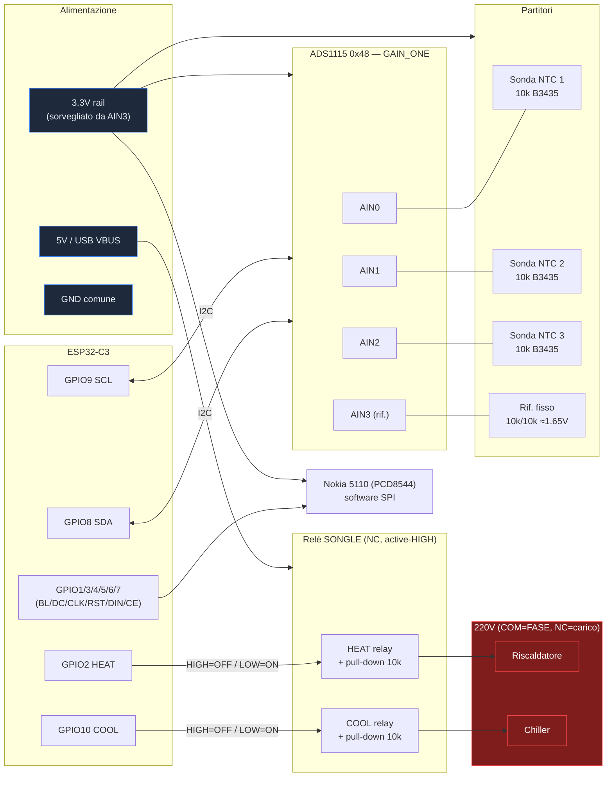

# Aquatermostat — schema circuito attuale

Firmware ESP32-C3. Tutte le tensioni logiche a **3.3V** (il C3 NON è 5V-tolerant).
Diagramma a blocchi (Mermaid, renderizzato da GitHub) + schema ASCII dettagliato sotto.



```
                                   ESP32-C3 Super Mini
                          ┌───────────────────────────────────┐
                          │                                   │
          I2C SDA ────────┤ GPIO8                       GPIO2 ├──── HEAT relay IN   (strapping pin)
          I2C SCL ────────┤ GPIO9                      GPIO10 ├──── COOL relay IN
                          │                                   │
   Nokia 5110  CLK ───────┤ GPIO4                       GPIO1 ├──── Nokia 5110 BL (backlight PWM)
   Nokia 5110  DIN ───────┤ GPIO6                       GPIO3 ├──── Nokia 5110 DC
   Nokia 5110  CE  ───────┤ GPIO7                       GPIO5 ├──── Nokia 5110 RST
                          │                                   │
                          │  3V3   GND   5V(VBUS)   USB-C      │
                          └───┬─────┬──────┬─────────┬─────────┘
                              │     │      │         └── flash / serial / alimentazione
                         3.3V │     │ GND  │ 5V (per i moduli relè)
                              │     │      │
```

## 1) Sensori — ADS1115 (I2C 0x48, GAIN_ONE ±4.096V)

```
          3.3V ──┬───────────┬───────────┬───────────┐
                 │           │           │           │
              Rfix 10k    Rfix 10k    Rfix 10k     R1 10k       <- partitori
                 │           │           │           │
   AIN0 ─────────┤  AIN1 ────┤  AIN2 ────┤  AIN3 ────┤          <- ingressi ADS1115
                 │           │           │           │
              NTC1 10k    NTC2 10k    NTC3 10k     R2 10k       <- NTC (sonde) + rif. fisso
              B=3435      B=3435      B=3435         │
                 │           │           │           │
          GND ───┴───────────┴───────────┴───────────┘

   ADS1115:  VDD=3.3V  GND=GND  SCL=GPIO9  SDA=GPIO8  ADDR=GND (0x48)
```

- **Sonde 1-3** su AIN0/AIN1/AIN2: partitore `3.3V → Rfix(10k) → AINx → NTC(10k,B3435) → GND`.
  - `Rntc = Rfix · Vadc/(Vcc − Vadc)`; a 25°C ≈ 1.65V. NTC sul lato GND → Vadc SALE quando l'acqua si raffredda.
  - Tutte e 3 le sonde **nello stesso punto** della vasca.
- **AIN3 = riferimento ADC** (guardia common-mode): partitore **fisso** `3.3V → R1(10k) → AIN3 → R2(10k) → GND` = metà rail ≈ **1.65V** (misurato 1.647V).
  - Non misura temperatura: è un valore NOTO e STABILE. Se l'ADC lo legge fuori da `1.65 ± 0.10V` → rail 3.3V o ADC derivati → fail-safe.
  - ⚠️ Errore tipico sonde: manca il GND in fondo → AIN flotta ~3.3V → legge ~418°C → invalida (NaN).

## 2) Attuatori — doppio relè SONGLE (active-HIGH, contatto Normally-Closed)

```
   GPIO2  ──┬── HEAT relay IN          GPIO10 ──┬── COOL relay IN
            │                                   │
         R 10k  pull-DOWN                     R 10k  pull-DOWN
            │                                   │
           GND                                 GND

   Modulo relè (x2):  VCC=5V   GND=GND(comune col C3)   IN=GPIO

   Livello IN  →  bobina       →  contatto NC   →  carico
   ─────────────────────────────────────────────────────────
   LOW/riposo  →  diseccitata  →  CHIUSO        →  carico ON   (fail-safe)
   HIGH        →  eccitata     →  APERTO        →  carico OFF

   A boot/reset/crash: pull-down tiene IN basso → entrambi i carichi ON.
```

### Cablaggio 220V (relè indipendenti)

```
   FASE (L) ──┬──────────────── HEAT COM ──[NC]── RISCALDATORE ──┐
              │                                                 │
              └──────────────── COOL COM ──[NC]── CHILLER ───────┤
                                                                 │
   NEUTRO (N) ───────────────────────────────────────────────────┴── (ritorno carichi)

   NO (Normally-Open) = NON usato.   PE (terra) → chassis di heater e chiller.
```

> ⚠️ **Requisito fail-safe**: termostato interno del RISCALDATORE < termostato interno del CHILLER
> (es. 24.5°C vs 26°C). In fail-safe entrambi i carichi sono ON e delegano ai loro termostati: se
> sono mal tarati si combattono.

## 3) Display Nokia 5110 (PCD8544) — software SPI, best-effort

| 5110 | ESP32-C3 | Note |
|------|----------|------|
| CLK  | GPIO4    | SPI clock |
| DIN  | GPIO6    | SPI MOSI |
| DC   | GPIO3    | data/command |
| CE   | GPIO7    | chip select |
| RST  | GPIO5    | reset |
| BL   | GPIO1    | backlight (PWM, luminosità da web) |
| VCC  | 3V3      | **solo 3.3V** |
| GND  | GND      | |

## Mappa pin ESP32-C3 (riassunto)

| GPIO | Funzione | Modulo |
|------|----------|--------|
| 1  | LCD backlight (PWM) | Nokia 5110 |
| 2  | HEAT relay IN (strapping pin) | relè #1 |
| 3  | LCD DC | Nokia 5110 |
| 4  | LCD CLK | Nokia 5110 |
| 5  | LCD RST | Nokia 5110 |
| 6  | LCD DIN | Nokia 5110 |
| 7  | LCD CE | Nokia 5110 |
| 8  | I2C SDA | ADS1115 |
| 9  | I2C SCL | ADS1115 |
| 10 | COOL relay IN | relè #2 |

## Note alimentazione

- **3.3V** del C3 alimenta: ADS1115, tutti i partitori sonde + AIN3, display. È il rail sorvegliato da AIN3.
- **5V (VBUS/USB)** alimenta le bobine dei moduli relè. GND comune tra C3, ADS1115, relè, display.
- ⚠️ Prima di collegare la 220V: verifica la polarità dei relè SENZA rete elettrica. NC active-HIGH → a riposo i carichi sono **ON**, non OFF.
